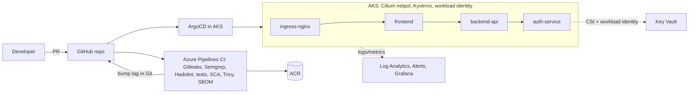

# ShopSphere - Azure DevSecOps (MNC-style) practice project

3 microservices (frontend, backend-api, auth-service) on AKS, built and secured with Azure DevOps pipelines, deployed with GitOps (ArgoCD).
**Everything runs from a browser: Azure Cloud Shell + Azure Portal + Azure DevOps portal + GitHub. Nothing to install locally.**

START HERE -> [`EXECUTION-GUIDE.md`](EXECUTION-GUIDE.md)

| Folder | Contents |
|---|---|
| `app/` | Source + hardened Dockerfiles |
| `infra/terraform/` | VNet, NSG, ACR, AKS, Key Vault, Log Analytics, alerts, Policy, optional Postgres |
| `k8s/helm/shopsphere/` | Chart: deployments, probes, HPA, PDB, quotas, NetworkPolicies, ingress, CSI secrets |
| `k8s/policies/kyverno/` | Admission policies |
| `k8s/gitops/` | ArgoCD Applications (dev/qa/prod) |
| `pipelines/` | CI per service, infra pipeline, promotion, DAST |
| `scripts/` | Cloud Shell scripts 00-07 + stop/start/teardown |
| `labs/`, `docs/` | Break-it labs, threat model, RACI, runbooks, interview Q&A |

Practice-grade trade-offs (documented in the guide): public AKS API (private cluster = design-only), no Azure Firewall/App Gateway, single cluster with 3 namespaces. All code is unverified against your tenant; versions must be checked against official docs.
